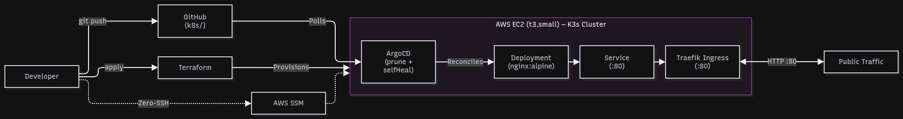
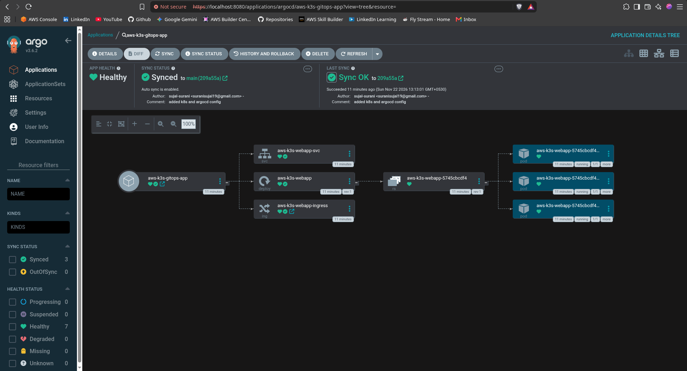
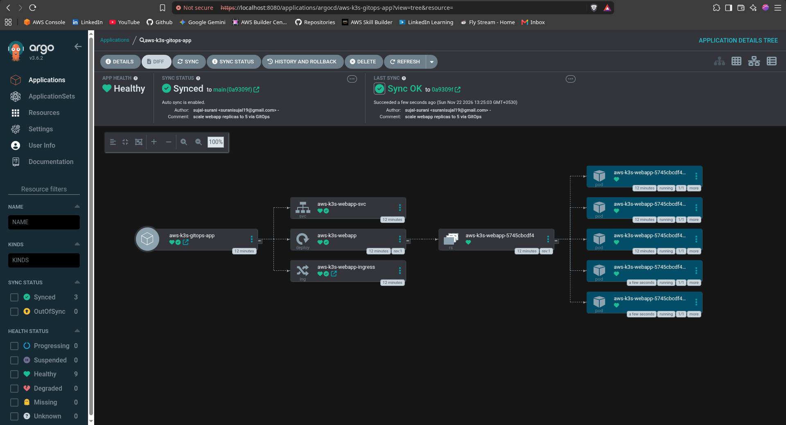

# AWS K3s GitOps Platform with Terraform & ArgoCD

A declarative, production-style GitOps workflow on AWS using **Terraform**, **K3s**, **Traefik Ingress**, and **ArgoCD**. Infrastructure is provisioned as code with zero-SSH access via **AWS Systems Manager (SSM)**, and Kubernetes workloads are continuously reconciled from Git with automated pruning and self-healing.

---

## Architecture



---

## Key Engineering Highlights

* **Infrastructure as Code:** AWS EC2 (`t3.small`), Security Groups, and IAM Instance Profiles provisioned declaratively with Terraform.
* **Zero-SSH Security:** No SSH keys or open port `22`; all host administration is performed through AWS Systems Manager (SSM).
* **Declarative GitOps:** ArgoCD manages the `aws-k3s-gitops-app` application via `argocd/application.yaml` with `prune: true` and `selfHeal: true`.
* **Production Pod Specs:** Workloads include CPU/memory `requests` and `limits` plus HTTP `readinessProbe` checks to ensure zero-downtime rollouts.

---

## Repository Structure

```text
k3s-argocd-gitops-aws/
├── terraform/            # AWS EC2, IAM (SSM), and Security Group IaC
├── k8s/                  # Declarative Kubernetes manifests (source of truth)
│   ├── deployment.yaml   # Nginx Deployment with resource limits & readiness probe
│   ├── service.yaml      # ClusterIP Service
│   └── ingress.yaml      # Traefik Ingress configuration
├── argocd/
│   └── application.yaml  # ArgoCD Application manifest (auto-sync + self-heal)
└── screenshots/          # Verification captures
```

---

## Deployment & Verification

### 1. Provision Infrastructure
```bash
cd terraform
terraform init
terraform apply -auto-approve
```

### 2. Install K3s (via AWS SSM)
```bash
aws ssm start-session --target <INSTANCE_ID>
curl -sfL [https://get.k3s.io](https://get.k3s.io) | INSTALL_K3S_EXEC="--tls-san <EC2_PUBLIC_IP>" sh -
```
Copy `/etc/rancher/k3s/k3s.yaml` to `~/.kube/config` locally, replace `127.0.0.1` with `<EC2_PUBLIC_IP>`, and verify:
```bash
kubectl get nodes
```

### 3. Install ArgoCD & Apply GitOps Application
```bash
kubectl create namespace argocd
kubectl apply -n argocd --server-side --force-conflicts \
  -f [https://raw.githubusercontent.com/argoproj/argo-cd/stable/manifests/install.yaml](https://raw.githubusercontent.com/argoproj/argo-cd/stable/manifests/install.yaml)

kubectl apply -f argocd/application.yaml
```

### 4. Access ArgoCD UI
```bash
kubectl -n argocd get secret argocd-initial-admin-secret \
  -o jsonpath="{.data.password}" | base64 -d; echo

kubectl port-forward svc/argocd-server -n argocd 8080:443
```
Open `https://localhost:8080` and log in as `admin`.

---

## GitOps Proof & Verification

1. **Automated Sync:** Pushing a replica change (`3 -> 5`) in `k8s/deployment.yaml` automatically triggers ArgoCD to reconcile the cluster to the new Git commit.
2. **Drift Detection & Self-Healing:** Manually scaling the deployment out-of-band (`kubectl scale deployment aws-k3s-webapp --replicas=1`) is detected and automatically reverted by ArgoCD to match Git.
3. **Ingress Verification:** `curl -I http://<EC2_PUBLIC_IP>` returns `HTTP/1.1 200 OK` via Traefik.

### ArgoCD Resource Tree (Synced & Healthy)


### Automated GitOps Scale-Up


---

## Cleanup
```bash
cd terraform
terraform destroy -auto-approve
```
---

<div align="center">

**Architected & Maintained by [Sujal Surani](https://github.com/sujal-surani)**  
<sub>Cloud & DevOps · Terraform · K3s · ArgoCD · AWS</sub>

[](https://github.com/sujal-surani)
[![LinkedIn](https://img.shields.io/badge/LinkedIn-0A66C2?style=flat-square&logo=)](https://www.linkedin.com/in/sujal-surani)

</div>